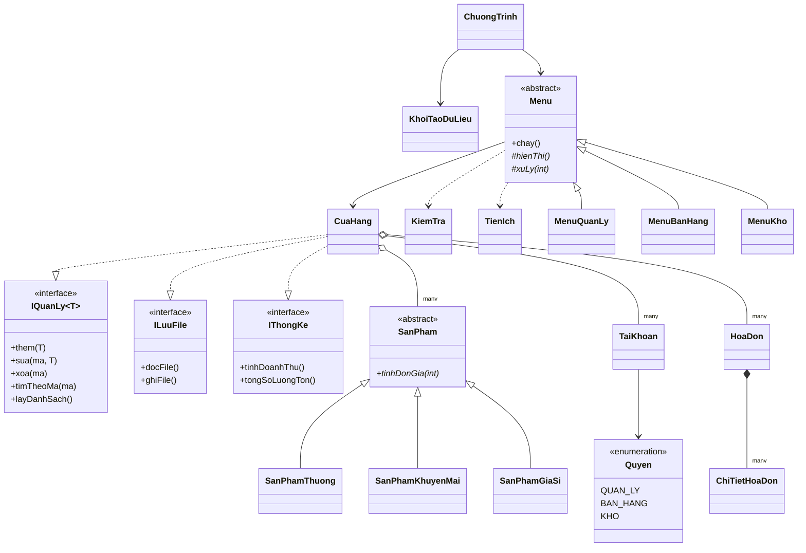

# Sơ đồ các thành phần nhóm trưởng trong phiên bản demo

> Có thể dán khối Mermaid vào Mermaid Live Editor hoặc Markdown Viewer để xem. Đây **không phải** sơ đồ lớp gốc do nhóm gửi; chỉ thể hiện quan hệ đang được cài đặt trong source.

